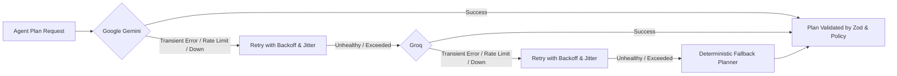
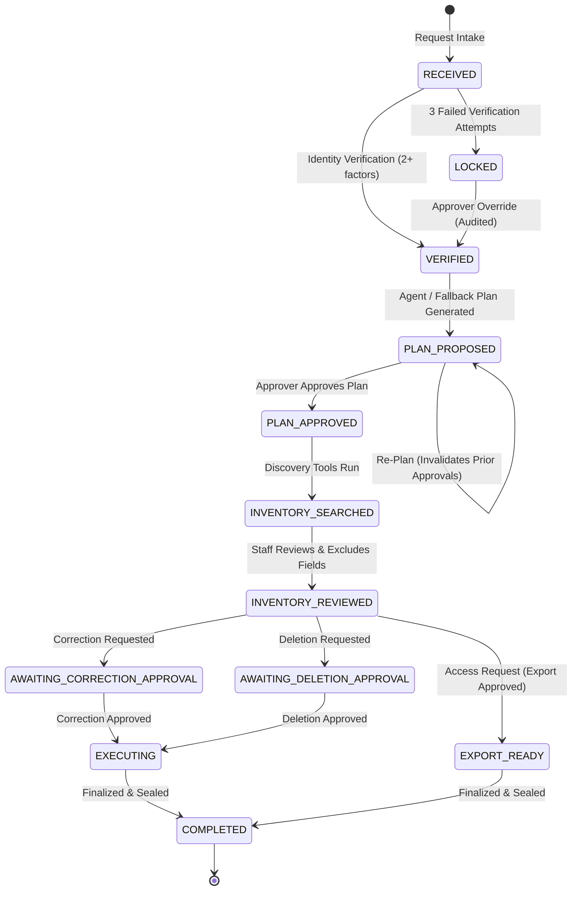
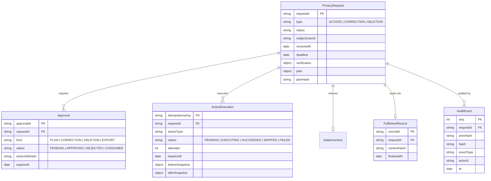

# Data Privacy Request Fulfilment Workbench

> **INTERNAL TOOL FOR PRIVACY-OPERATIONS STAFF ONLY**  
> **DISCLAIMER:** *This tool follows internal organizational policy only. It does not provide legal advice or guarantee compliance with any law or regulation. Final decisions rest with authorized staff.*

The **Data Privacy Request Fulfilment Workbench** is an internal operations platform designed for privacy staff to process and fulfil data-subject requests (**ACCESS**, **CORRECTION**, **DELETION**) across disparate mock data sources.

The system enforces organizational policy version **v2025.1**, strict four-eyes human review, separation of duties, resilient AI orchestration with automated failover, append-only hash-chained audit logging, and cryptographic verification of all exports and records.

---

## Architecture Overview

```mermaid
flowchart TD
    subgraph UI ["User Interface (Next.js App Router + shadcn/ui)"]
        Dashboard["Dashboard (app/page.tsx)"]
        Intake["Intake Portal (app/requests/new)"]
        Workbench["Request Workbench (app/requests/[id])"]
        PolicyView["Policy Viewer (app/policy)"]
        AuditView["Audit Chain Explorer (app/audit)"]
        SourcesView["Mock Sources Explorer (app/sources)"]
    end

    subgraph API ["Next.js Route Handlers (app/api/**)"]
        RateLimiter["Rate Limiter (120 req/min) & Body Size Guard (1MB)"]
        Handlers["API Handlers (Strict Zod Validation)"]
    end

    subgraph CoreServices ["Application Core Services"]
        VerificationSvc["Verification Service"]
        SearchSvc["Search & Discovery Service"]
        InventorySvc["Inventory Service"]
        RedactionSvc["Redaction Engine"]
        ApprovalSvc["Approval Engine (Four-Eyes Principle)"]
        ActionSvc["Action Execution Engine (Idempotent Leases)"]
        FulfilmentSvc["Fulfilment & Sealing Service"]
        ExportSvc["Export Generator (JSON & HTML)"]
    end

    subgraph AIOrchestration ["AI Planning & Resilience"]
        AIRouter["AI Router (Circuit Breaker & Retry)"]
        GeminiProvider["Primary: Google Gemini (@google/genai)"]
        GroqProvider["Secondary: Groq (groq-sdk)"]
        FallbackPlanner["Tertiary: Deterministic Fallback Planner"]
        AgentEngine["Agent Workflow Engine (agent/agent.ts)"]
    end

    subgraph ToolRegistryLayer ["Tool Registry (Strict RBAC)"]
        ToolReg["Tool Registry (tools/registry.ts)"]
        ReadOnlyTools["Read Tools (Allowed for Agent & Ops)"]
        ProposeTools["Propose-Only Tools (Agent Proposes Actions)"]
        WriteTools["Write Tools (System-Only with Active Human Approval)"]
    end

    subgraph PolicyAndAudit ["Security, Policy & Integrity"]
        PolicyEngine["Org Policy Engine (policy/org-policy.ts v2025.1)"]
        AuditLog["Append-Only SHA-256 Hash Chained Audit Log"]
    end

    subgraph Storage ["Database (MongoDB)"]
        RequestsColl["PrivacyRequests & Approvals"]
        ExecutionsColl["ActionExecutions & FulfilmentRecords"]
        AuditColl["AuditEvents (prevHash -> hash sequence)"]
        MockSources[("Mock Data Sources\n- UserProfiles\n- SupportTickets\n- ActivityLogs")]
    end

    UI --> RateLimiter --> Handlers
    Handlers --> CoreServices
    CoreServices --> PolicyEngine
    CoreServices --> AuditLog
    CoreServices --> Storage

    Workbench --> AgentEngine
    AgentEngine --> AIRouter
    AIRouter --> GeminiProvider
    AIRouter -. Failover .-> GroqProvider
    AIRouter -. Failover .-> FallbackPlanner
    AgentEngine --> ToolReg
    ToolReg --> ReadOnlyTools & ProposeTools
    ActionSvc --> WriteTools
    ReadOnlyTools & WriteTools --> MockSources
    AuditLog --> AuditColl
```



---

## Quick Setup (< 5 Minutes)

### 1. Prerequisites
- **Node.js**: v18.18+ or v20+
- **MongoDB**: MongoDB 6.0+ instance (local or MongoDB Atlas connection string)
- **API Keys** *(Optional for fallback planner, recommended for live AI)*:
  - Google Gemini API Key (`GEMINI_API_KEY`)
  - Groq API Key (`GROQ_API_KEY`)

### 2. Environment Configuration
Create a `.env.local` file at the repository root:

```bash
# Database
MONGODB_URI="mongodb+srv://<user>:<password>@cluster.mongodb.net/privacy_workbench?retryWrites=true&w=majority"
MONGODB_DB="privacy_workbench"

# AI Providers (Server-side only; never exposed to the client)
GEMINI_API_KEY="your-gemini-api-key-here"
GEMINI_MODEL="gemini-2.5-flash"

GROQ_API_KEY="your-groq-api-key-here"
GROQ_MODEL="llama-3.3-70b-versatile"

# Optional: Transient failure chaos testing (true/false)
CHAOS_MODE=false
```

### 3. Install Dependencies & Seed Mock Data
```bash
# Install dependencies
npm install

# Seed mock database with test profiles, tickets, and logs
npm run seed
```

### 4. Reviewer Test Accounts & Credentials
The workbench uses mock authorization managed via the role switcher in the header:

| Role Name | Demo Actor | Actor ID | Responsibilities |
| :--- | :--- | :--- | :--- |
| **Analyst** | **Asha (Analyst)** | `u-analyst` | Intake, factor verification, AI plan trigger, inventory discovery, execution of approved writes, finalization. |
| **Approver** | **Rahul (Approver)** | `u-approver` | Four-Eyes review: approves/rejects plans, corrections, deletions, exports, verification lockout overrides, deadline extensions. |

### 5. Completed vs. Excluded Scope

| Feature Area | Completed Scope | Intentionally Excluded Scope |
| :--- | :--- | :--- |
| **Request Types** | `ACCESS`, `CORRECTION`, `DELETION` | Non-standard regulatory requests (e.g., automated portability transfers to external servers). |
| **Data Repositories** | Multi-source synthetic MongoDB stores (`user_profiles`, `support_tickets`, `activity_logs`). | Live production enterprise silos (e.g., Salesforce, Snowflake, AWS S3). |
| **AI Orchestration** | Multi-provider failover (`Gemini` ➔ `Groq` ➔ `Deterministic Fallback Planner`) with Zod validation. | Unrestricted agent autonomous database mutation (strictly prohibited by policy). |
| **Safety Guardrails** | Four-Eyes approval separation, immutable SHA-256 hash-chained audit log, idempotency leases, canary leak protection. | External third-party legal research or statutory advice engines. |
| **Authentication** | Dual-role cookie switcher (`Asha (Analyst)` / `Rahul (Approver)`) with 403 audit logging. | Production OAuth / SAML SSO IdP integration. |

### 6. Run Development Server
```bash
npm run dev
```
Open [http://localhost:3000](http://localhost:3000) to access the Workbench.

---

## AI Resilience & Failover Architecture

The system uses a unified multi-tier provider interface with automated failover:



### Failover Hierarchy:
1. **Primary (`gemini`)**: Google Gemini 2.5 (`@google/genai`). High-capacity structured output.
2. **Secondary (`groq`)**: Groq Cloud (`groq-sdk`, LLaMA 3.3). Ultra-low latency fallback.
3. **Tertiary (`deterministic`)**: Fallback planner (`agent/fallback-planner.ts`). Completely offline, zero external API dependency. Generates complete, valid plans adhering to `orgPolicy.v2025.1`.

### Circuit Breaker & Health Tracking
- Each provider tracks consecutive failures. After 3 consecutive failures, the provider is temporarily tripped open.
- All failover events (`AI_PROVIDER_FAILOVER` and `AI_PROVIDER_FALLBACK_PLANNER`) are recorded in the append-only audit trail with latency and error metrics.

### Testing Failover:
- **Test Groq Failover**: Blank or set an invalid `GEMINI_API_KEY=invalid` in `.env.local`. Generate a plan; notice the badge in the UI: `Generated by Groq (llama-3.3-70b-versatile)` with failover audited.
- **Test Fallback Planner**: Blank both `GEMINI_API_KEY` and `GROQ_API_KEY`. Generate a plan; notice the badge: `Generated by Rule-based Fallback (deterministic)` with zero downtime.

---

## Organizational Policy & Agent Constraints

All operations are strictly bounded by organizational policy `v2025.1` (`policy/org-policy.ts`):

### 1. The Agent NEVER Has Write Access
- The LLM agent receives **read-only tools** (`search_user_profile`, `search_support_tickets`, `search_activity_logs`) and **propose-only tools** (`propose_action`, `flag_risk`).
- Write tools (`apply_correction`, `apply_deletion`) are **never registered to the LLM agent**.
- Even if prompt injection attempts to trick the agent into executing writes, the agent runtime rejects the attempt immediately.

### 2. Four-Eyes Principle & Approval Separation
- Write actions (`CORRECTION`, `DELETION`) and sensitive exports (`EXPORT`) require separate human approval by an authorized role (`approver`).
- **Correction and Deletion approvals are SEPARATE** and cannot be combined.
- The person who submitted or requested an action cannot approve it (four-eyes principle).

### 3. Expiry and Plan Invalidation
- Approvals carry an explicit TTL (default 24 hours).
- If the plan changes (re-plan), the plan hash changes, immediately invalidating any prior approvals.

### 4. Strict Idempotency Guarantees
- Every mutation calculates an idempotency key:
  $$\text{Key} = \text{SHA256}(\text{requestId} + \text{type} + \text{source} + \text{recordId} + \text{field} + \text{payloadHash})$$
- Actions execute under an atomic MongoDB lease (`ActionExecution`). Duplicate calls or re-runs immediately return the recorded result without duplicating changes.

---

## Data Model & State Machine

### Request Lifecycle State Machine



### Core Entities & Relationships



---

## Verification, Testing & Chaos Mode

### Automated Test Suite
The project includes complete integration test coverage using `vitest` and `mongodb-memory-server`:

```bash
# Run all 14 test suites (106 unit + end-to-end integration tests)
npm test
```

### Verified Test Matrix:
- **ACCESS happy path**: Complete review and export generation with canary leak checks (verifies restricted canaries never leak).
- **CORRECTION idempotency**: Approve, execute, retry duplicate $\rightarrow$ single persistent change.
- **DELETION retention exceptions**: Open and `legal_hold` tickets along with security-flagged logs are safely skipped under policy retention rules `R-TKT-1`, `R-TKT-2`, `R-LOG-1`; user profile is anonymized.
- **Verification lockouts & approver overrides**: Fails 3x $\rightarrow$ locks $\rightarrow$ requires approver override.
- **Prompt injection defense**: Request and ticket texts containing prompt injection payloads cannot invoke write tools or bypass approvals.
- **Approval invalidation**: Approval expiration and re-planning invalidate prior approvals.
- **Chaos Mode resilience**: `CHAOS_MODE=true` simulates transient execution crashes; retry recovers cleanly under idempotency leases.
- **AI Failover**: Primary provider downtime triggers secondary; secondary downtime triggers deterministic fallback planner.
- **Audit chain integrity**: End-to-end cryptographic verification of the sequential SHA-256 hash chain.

---

## 5-Minute End-to-End Pipeline Demo

You can run the fully automated end-to-end pipeline demonstration via the CLI:

```bash
npm run demo
```

The script walks through:
1. **Intake**: Creates a new request.
2. **Verification**: Submits factor proofs and passes identity verification.
3. **Agent Planning**: Generates a policy-checked plan with proposed actions and risks.
4. **Plan Approval**: Human approver approves the proposed plan.
5. **Inventory Search & Review**: Discovers records across all mock sources and applies policy redactions.
6. **Write Approval**: Submits and approves write actions under the four-eyes principle.
7. **Execution & Idempotency Replay**: Executes mutations and demonstrates idempotency upon replay.
8. **Final Record Sealing**: Computes cryptographic content hash and seals the record.
9. **Audit Chain Verification**: Validates the global SHA-256 hash chain.

### Manual UI Walkthrough
1. **Dashboard** (`/`): View open requests, SLA countdowns, and quick filters.
2. **New Request** (`/requests/new`): Submit an intake request for Priya Sharma (`priya.sharma@example.test`).
3. **Workbench** (`/requests/[id]`):
   - **Verification Tab**: Verify identity using Account ID `USR-001` and last order city `San Francisco`.
   - **Plan Tab**: Click **Generate Plan**; inspect risk breakdown and provider attribution.
   - **Inventory Tab**: Click **Discover Sources**; review discovered fields and exclusions.
   - **Approvals Tab**: Review separate approval cards for Correction / Deletion.
   - **Final Record Tab**: Review finalized cryptographic record.
4. **Audit Explorer** (`/audit`): Click **Verify chain integrity** to validate the unbroken hash chain.

---

## Production Deployment Details

The application is built on Next.js 16 App Router and standard Node.js runtime.

### Recommended Deployment Options

#### Option A: Vercel / Railway / Render
1. Push this repository to GitHub or GitLab.
2. In your hosting provider dashboard (e.g., Vercel, Railway, Render), import the project.
3. Configure the following environment variables:
   - `MONGODB_URI`: Connection string to your MongoDB Atlas cluster.
   - `GEMINI_API_KEY`: Google Gemini API key.
   - `GROQ_API_KEY`: Groq API key.
4. Set Build Command: `next build --webpack` (or `npm run build`).
5. Seed initial mock database if needed: `npm run seed`.

#### Option B: Docker / Self-Hosted Node.js Server
```bash
# 1. Build production bundle
npm run build

# 2. Run production server
npm run start
```
The server listens on `http://localhost:3000` (or the port defined by `PORT`).

---

## Known Limitations & Security Scope

1. **Mock Data Only**: All databases (User Profiles, Support Tickets, Activity Logs) use synthetic mock data. Real PII must never be stored.
2. **Mock Verification**: Identity verification matches mock database fields. In a production environment, this would integrate with an external identity verification provider.
3. **No External Legal Research**: This tool strictly follows the local configuration file `policy/org-policy.ts` (version `v2025.1`). It does not consult external legal authorities or interpret statutes.
4. **Server-Side API Key Isolation**: AI provider keys (`GEMINI_API_KEY`, `GROQ_API_KEY`) are strictly isolated to server-side Node.js route handlers and are never bundled into client assets.

---

## Compliance Disclaimer

> **This tool follows internal organizational policy only. It does not provide legal advice or guarantee compliance with any law or regulation. Final decisions rest with authorized staff.**

*All UI surfaces, exports, plans, and final fulfilment records display this disclaimer in accordance with organizational policy v2025.1.*
